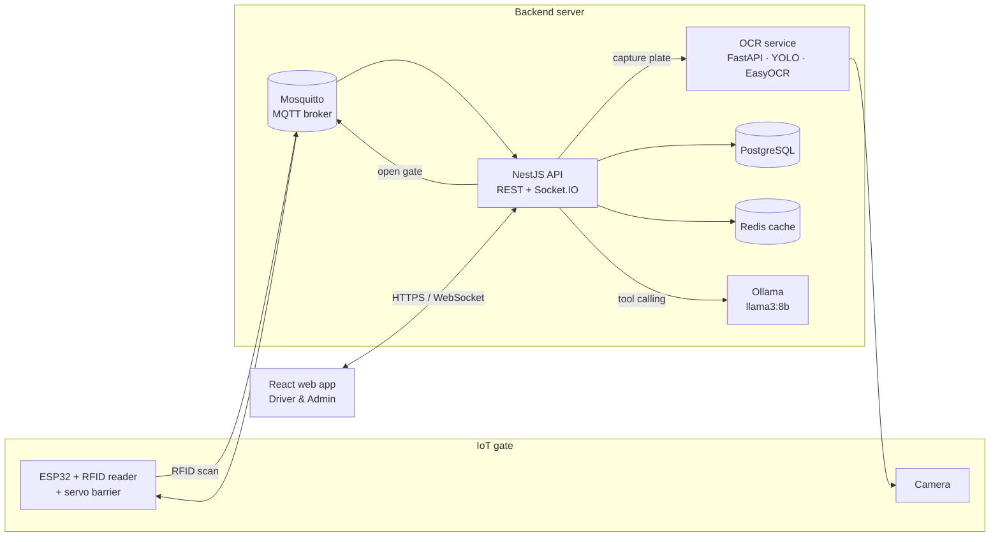

# Smart Parking Platform: Backend

> **A Scalable and Resource-Efficient Smart Parking Platform with a Local LLM-Powered AI Assistant**
> Graduation thesis, B.Sc. Computer Science, VNUK Institute (The University of Da Nang), 2026

**Live demo:** [smart-parking-ui.pages.dev](https://smart-parking-ui.pages.dev) · **API:** `https://api.vinhpham131.id.vn/api` · **Frontend repo:** [smart-parking-ui](https://github.com/VinhPham131/smart-parking-ui)

---

## What it does

Smart Parking is an end-to-end platform that automates how a parking facility runs: from the moment a car reaches the gate to the moment the admin reviews the day's revenue.

- **Automated gate check-in / check-out.** An ESP32 gate reads the driver's RFID card and sends it over MQTT. The backend then has a camera read the license plate with YOLO + OCR, checks that it matches the vehicle registered to that card, and opens the gate only if both agree.
- **Self-service for drivers.** Drivers register vehicles, request RFID cards, book parking slots in advance, follow their parking history and pay from a member wallet.
- **Real-time operations for admins.** A live dashboard shows every parking area and slot, with check-ins, check-outs and notifications pushed over WebSockets.
- **AI administrative assistant.** Admins can ask questions in plain language, such as *"how many reservations are pending on 08/07/2026?"* or *"approve all of them"*. A locally hosted LLM picks the right backend tool and runs it. No data leaves the server.
- **Built to run on small hardware.** Under load tests the backend handled about **100 requests/second with under 0.5 s average response time**, while limited to **1 CPU core and 2 GB RAM** with 10,000 records in the database.

## Architecture



### Check-in flow

1. The driver taps an RFID card at the gate. The ESP32 publishes the card UID to MQTT.
2. The backend looks up the card, then the vehicle, then the registered license plate.
3. The OCR service captures several frames. YOLO finds the plate and EasyOCR reads it, and a vote across frames picks the final result.
4. If the plate read by the camera matches the registered plate and the area has a free slot, the backend opens a parking session, stores the captured image and tells the gate to open.
5. The admin dashboard and the driver's app update in real time.

Check-out runs the same checks in reverse, calculates the fee, charges it and frees the slot.

## Key features

| Area | Highlights |
|---|---|
| **Vehicle authentication** | Two-factor check that combines the RFID card with license plate recognition (YOLO + EasyOCR, multi-frame voting) |
| **Parking operations** | Parking areas and slots, live occupancy, parking sessions and history, plus slot maintenance and reservation states |
| **Reservations & payments** | Booking a slot in advance, hourly fee calculation, member wallet and payment history |
| **RFID lifecycle** | Drivers request a card, an admin approves it and the card is issued with a 1-year expiry |
| **Real-time** | Socket.IO gateways for parking status and personal notifications, with JWT-authenticated rooms |
| **AI assistant** | Custom function-calling loop on a local LLM, with 27 tools for reservations, parking history, sessions and areas, including bulk actions |
| **Security** | JWT auth with `user` / `admin` roles, global guards, DTO validation and a CORS allow-list |
| **Performance** | Redis caching with single-flight protection against cache stampedes, B-tree and trigram indexes for plate search, lean queries, and JWT role claims so requests skip extra DB lookups |

## Tech stack

| Layer | Technologies |
|---|---|
| Backend API | **NestJS 11**, TypeScript, TypeORM, Passport JWT, class-validator, Socket.IO |
| Data | **PostgreSQL**, **Redis** (cache-manager / ioredis) |
| IoT | **ESP32** (Arduino), MFRC522 RFID, servo barrier, **MQTT** (Mosquitto) |
| Computer vision | **Python FastAPI**, **YOLO** (Ultralytics, custom-trained plate model), **EasyOCR**, OpenCV |
| AI | **Ollama** running `llama3:8b` locally, with custom tool registry and JSON function calling |
| Frontend | React 19, TypeScript, Vite, Tailwind CSS ([separate repo](https://github.com/VinhPham131/smart-parking-ui)) |
| DevOps | **Docker Compose**, **Cloudflare Tunnel** (HTTPS without exposing ports), Cloudflare Pages, GitHub Actions CI |
| Testing | Jest, **k6** load testing |

## Performance evaluation

The backend was containerized and limited to **1 CPU and 2 GB RAM**, with 10,000 records loaded into the database. k6 scenarios hit the main read-heavy endpoints, and five optimizations were compared against a baseline:

1. JWT claim embedding, so requests no longer need a database lookup for authentication
2. B-tree indexes on frequently filtered columns
3. PostgreSQL GIN trigram index for partial license plate search
4. Redis cache with a single-flight mechanism
5. Query-level optimization (selecting only needed columns, leaner joins)

**Result:** about **100 req/s sustained** with an **average response time under 0.5 s** on most endpoints, a clear improvement over the baseline.

## Project structure

```text
src/
├── auth/              JWT authentication, guards, roles
├── parking-areas/     Areas & slots
├── parking-sessions/  Check-in / check-out logic
├── parking-history/   Completed sessions
├── vehicles/          Vehicle registration
├── rfid/              RFID cards
├── rfid_requests/     Card issuance workflow
├── reservations/      Slot booking
├── payments/          Fees & wallet
├── mqtt/              Gate communication
├── camera/            OCR service client
├── gateways/          Socket.IO real-time events
├── ai-agents/         LLM assistant: tool registry, prompts, tools
├── analytics/         Admin statistics
└── cache/             Redis caching layer
ocr-service/           FastAPI license plate recognition microservice
```

## Deployment

The live demo runs entirely on free infrastructure:

- **Frontend** on Cloudflare Pages
- **Backend, Redis and MQTT** on Docker Compose on a self-hosted machine, reachable through a **Cloudflare Tunnel**
- **OCR and the LLM** natively on the same machine, because they need the camera and GPU

## Author

**Phạm Quang Vinh**, B.Sc. Computer Science, VNUK Institute for Research and Executive Education, The University of Da Nang

